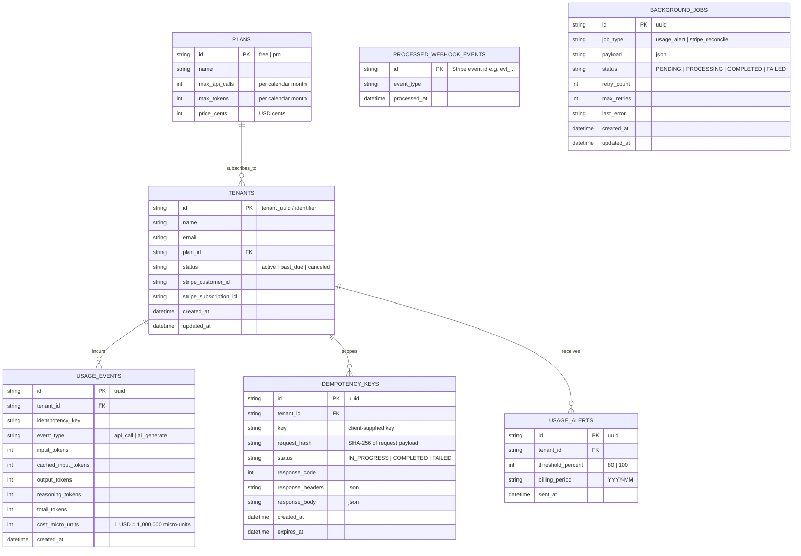
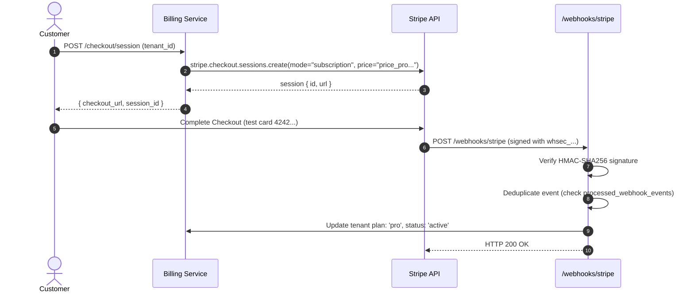

# Usage Metering & Billing Engine — Architecture & Design Document

## 1. Problem Statement & Scope

Modern SaaS and AI applications face three critical operational questions:
1. **How much has each customer used?**
2. **What does that usage cost?**
3. **Have they exceeded their plan quotas?**

In distributed environments, network failures and retries routinely produce duplicate billing events. If metering is not idempotent, customers are overcharged. If quota enforcement is sloppy at the boundary, services either reject legitimate calls or suffer unbilled overages. If payment webhooks are not verified and deduplicated, subscription plans fall out of sync with payment reality.

This service implements a production-grade, multi-tenant Usage Metering & Billing Engine providing:
- **Strict Exactly-Once Metering** via cryptographic and database-level idempotency keys.
- **Honest Quota Boundary Enforcement** returning RFC-compliant HTTP `429 Too Many Requests` (with `Retry-After`) and HTTP `402 Payment Required`.
- **Rigorous Multi-Category AI Token Money Math** with integer micro-unit precision (never floating-point numbers), pricing fresh input, cached input, output, and reasoning tokens correctly.
- **Stripe Subscription Integration** in test mode with raw-body cryptographic signature verification and idempotent event replay prevention.
- **Asynchronous Background Processing** for quota threshold alerting (80% / 100%) and nightly Stripe reconciliation.

### Explicit Non-Goals
- **Live Credit Card Processing**: Strictly runs in Stripe test mode. No real payment credentials or real money movement.
- **Dynamic Multi-Region Distributed Consensus**: Single primary database with ACID transactions rather than multi-region consensus algorithms.

---

## 2. System Architecture & Layer Sketch

The application follows a strict layered architecture separating HTTP routing/validation, business logic services, and persistence:

```
                  +----------------------------------------------------+
                  |                    HTTP Clients                    |
                  +----------------------------------------------------+
                                    |                ^
          POST /generate (billable) |                | Responses
          GET /usage (metrics)      |                | (200 / 429 / 402 / 400)
          POST /webhooks/stripe     v                |
                  +----------------------------------------------------+
                  |               HTTP & Validation Layer             |
                  |  - Express.js router                               |
                  |  - Zod request boundary schema validation          |
                  |  - Raw-body capture for Stripe HMAC-SHA256         |
                  +----------------------------------------------------+
                                    |
                                    v
                  +----------------------------------------------------+
                  |               Domain & Service Layer               |
                  |  - MeteringService (idempotency, quota deduction)  |
                  |  - PricingCalculator (integer micro-unit math)     |
                  |  - QuotaEnforcer (boundary limit evaluation)       |
                  |  - StripeWebhookService (signature, event sync)    |
                  |  - BackgroundJobQueue (alerts & reconciliation)    |
                  +----------------------------------------------------+
                                    |
                                    v
                  +----------------------------------------------------+
                  |               Data & Persistence Layer             |
                  |  - SQLite (WAL mode, foreign keys, ACID txs)       |
                  |  - Repositories (Tenant, Usage, Idempotency, etc.) |
                  |  - Deterministic Migrations & Seeders              |
                  +----------------------------------------------------+
```

---

## 3. Data Model & Schema

All persistence uses SQLite with foreign key enforcement and Write-Ahead Logging (`PRAGMA journal_mode = WAL`).



### Key Indices for High Performance:
- `usage_events(tenant_id, created_at)`: Instant monthly usage aggregate rollups.
- `usage_events(tenant_id, idempotency_key)`: Verification of deduplicated billing rows.
- `idempotency_keys(tenant_id, key)`: `UNIQUE` composite constraint ensuring database-level collision prevention.
- `tenants(stripe_customer_id)` and `tenants(stripe_subscription_id)`: Rapid webhook lookup.

---

## 4. Plans & Quotas Specification

| Plan | Monthly Price | Monthly API Calls Limit | Monthly AI Token Quota | Notes |
| :--- | :--- | :--- | :--- | :--- |
| **Free** | \$0.00 | 1,000 calls | 100,000 tokens | Entry tier; blocked on quota reach |
| **Pro** | \$29.00 | 50,000 calls | 5,000,000 tokens | Production tier; unlocked via Stripe Checkout |

---

## 5. Idempotency Strategy & Lifecycle

To satisfy the contract that retried requests record **exactly one** usage event and return an identical response:

1. **Client Identification**: The client provides an `Idempotency-Key` header (e.g., `Idempotency-Key: req_abc123`) along with the tenant identifier (`X-Tenant-ID: tenant_xyz`).
2. **Atomic Lookup & Reservation**:
   - Inside an atomic transaction, the engine queries `idempotency_keys` for `(tenant_id, key)`.
   - **Case A (Completed)**: If a completed record exists, verify the `request_hash`. If hashes match, return the recorded `response_code`, headers, and `response_body` with `Idempotent-Replay: true`. The billable action and quota deduction are skipped.
   - **Case B (In Progress)**: If an active in-flight request exists with the same key, return HTTP `409 Conflict` (`"Request currently processing"`).
   - **Case C (New Request)**: Atomically insert a record with status `IN_PROGRESS` and the SHA-256 hash of the request parameters.
3. **Execution & Boundary Check**:
   - Evaluate tenant status (if past_due / canceled -> HTTP 402).
   - Compute current usage vs quota limits.
   - If quota is exceeded -> record HTTP 429 response in the idempotency record and return HTTP 429.
   - If allowed -> insert into `usage_events`, compute exact cost, execute dummy billable action, record HTTP 200 response payload, and mark idempotency record as `COMPLETED`.
   - Commit transaction.

---

## 6. Boundary Honesty & Status Code Rules

- **Within Quota**: When `current_usage + requested_usage <= plan_limit`, the request is processed normally and HTTP `200 OK` is returned.
- **At Exact Boundary**: If a tenant has a limit of 1,000 calls, the 1,000th call is allowed.
- **Quota Exceeded (HTTP 429 Too Many Requests)**:
  - Triggered when `current_usage + requested_usage > plan_limit`.
  - Headers: `Retry-After: 3600` (or seconds until billing period reset).
  - Body:
    ```json
    {
      "error": "QuotaExceeded",
      "message": "Monthly token quota exceeded. Current: 100,000, Requested: 500, Limit: 100,000. Upgrade to Pro for higher limits.",
      "resource": "tokens",
      "plan": "free",
      "current_usage": 100000,
      "limit": 100000,
      "upgrade_url": "/checkout/session"
    }
    ```
- **Payment / Plan Inactive (HTTP 402 Payment Required)**:
  - Triggered when a tenant's subscription status is `past_due`, `unpaid`, or `canceled`.
  - Body:
    ```json
    {
      "error": "PaymentRequired",
      "message": "Subscription is unpaid or canceled. Please update your payment method.",
      "status": "past_due"
    }
    ```

---

## 7. AI Token Pricing Math (Integer Precision)

To prevent floating-point rounding errors (e.g. `0.1 + 0.2 !== 0.3`), all prices and costs are stored as **integer micro-units** (1 USD = 1,000,000 micro-units; 1 cent = 10,000 micro-units).

### Pinned Pricing Rates:
- **Base API Call Rate**: 1,000 micro-units (\$0.001 per call)
- **Standard Fresh Input Tokens**: 1 micro-unit per token (\$1.00 per 1,000,000 tokens)
- **Cached Input Tokens**: 0.25 micro-units per token (\$0.25 per 1,000,000 tokens — 75% discount)
  - *Integer formula*: `(cached_tokens * 25) / 100` micro-units
- **Output Tokens**: 4 micro-units per token (\$4.00 per 1,000,000 tokens)
- **Reasoning Tokens**: Billed identically to output tokens (4 micro-units per token) per provider specs:
  $$\text{effective\_output\_tokens} = \text{output\_tokens} + \text{reasoning\_tokens}$$

### Total Cost Formula:
$$\text{Cost} = (\text{API\_Calls} \times 1,000) + (\text{Input} \times 1) + \left\lfloor\frac{\text{Cached} \times 25}{100}\right\rfloor + ((\text{Output} + \text{Reasoning}) \times 4)$$

All intermediate and stored figures are non-negative integers.

---

## 8. Stripe Test-Mode Integration Flow



### Signature Verification & Deduplication:
- Raw body is preserved using `express.raw({ type: 'application/json' })`.
- Cryptographic verification with `stripe.webhooks.constructEvent(payload, header, secret)`.
- Replayed webhook events match existing entries in `processed_webhook_events` and return `200 OK { duplicate: true }` without touching tenant state.
- Bad signatures return `400 Bad Request` immediately.

---

## 9. Background Jobs (Alerts & Reconciliation)

1. **Quota Usage Alerts Worker**:
   - Triggers off the request path when usage reaches $\ge 80\%$ or $\ge 100\%$.
   - De-duplicates alert delivery per tenant per billing period.
   - Includes automatic retries with exponential backoff on notification failures.
2. **Nightly Stripe Reconciliation Job**:
   - Iterates all active tenants.
   - Compares local subscription status against Stripe's authoritative API view (`stripe.subscriptions.retrieve`).
   - Rectifies discrepancies resulting from missed or dropped webhooks, logging audit records.
